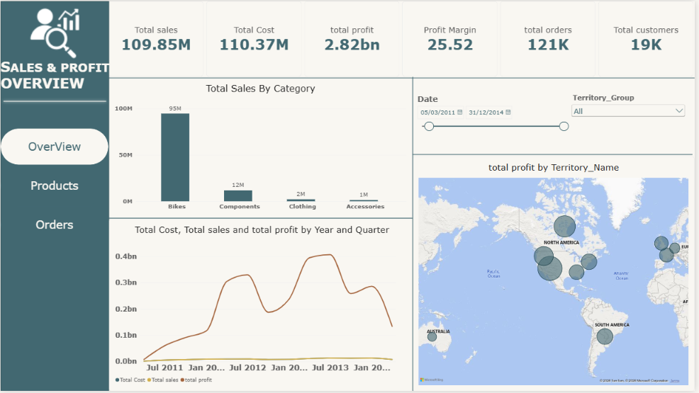
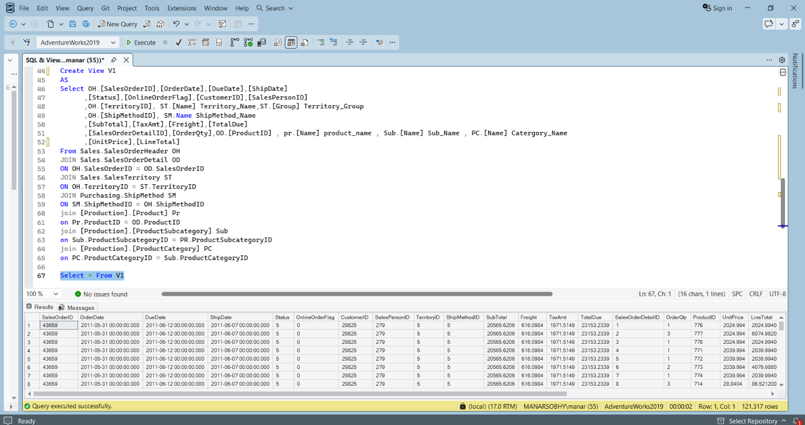
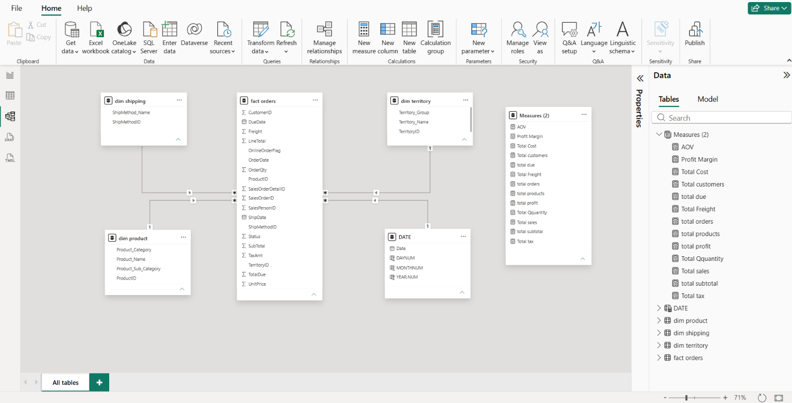
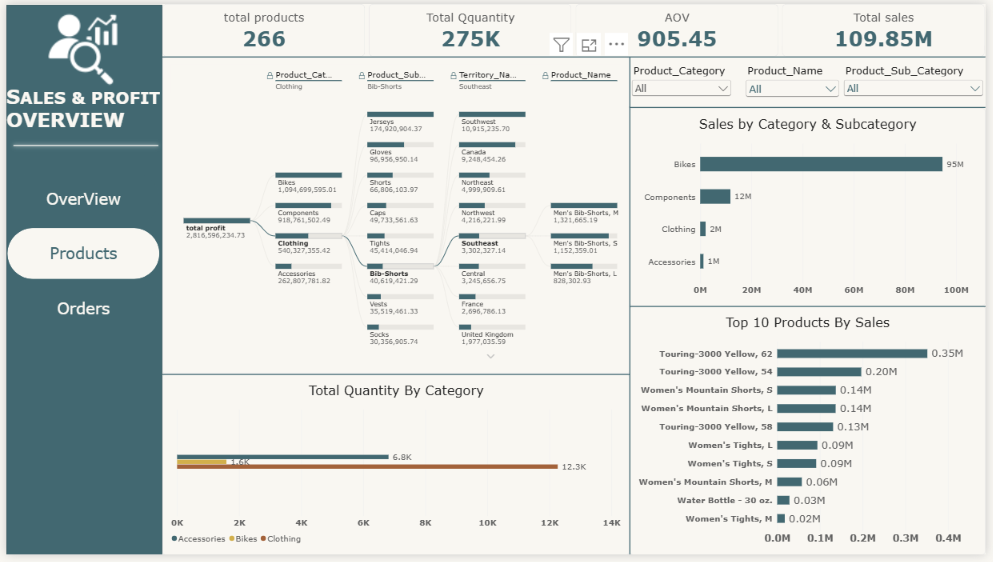
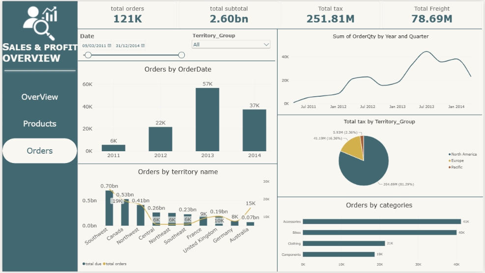

# 📊 Sales & Profit Overview Dashboard

**End-to-End Business Intelligence Solution using SQL Server & Power BI**

An interactive Power BI dashboard built on the **AdventureWorks2019** database. A SQL Server view prepares the data, a star-schema model organizes it, and DAX measures turn 121K+ sales records into clear insights on sales, profit, products, orders, and regional performance.



---

## 📌 Table of Contents
- [Business Problem](#-business-problem)
- [Tools & Technologies](#-tools--technologies)
- [Project Workflow](#-project-workflow)
- [Dashboard Pages](#-dashboard-pages)
- [Key KPIs](#-key-kpis)
- [Key Insights](#-key-insights)
- [Skills Demonstrated](#-skills-demonstrated)
- [Repository Structure](#-repository-structure)
- [How to Use](#-how-to-use)
- [Contact](#-contact)

---

## 🎯 Business Problem
Management needs one place to track sales and profit and answer questions like:
- Which product categories and products drive the most revenue and profit?
- Which territories perform best?
- How do orders, tax, and freight change over time?

---

## 🛠 Tools & Technologies
| Layer | Tool |
|---|---|
| Database | SQL Server (AdventureWorks2019) |
| Data Preparation | T-SQL (Joins, Views) |
| Data Modeling | Power BI, Star Schema |
| Calculations | DAX Measures |
| Visualization | Power BI Desktop |

---

## 🔄 Project Workflow

### 1️⃣ Data Preparation (SQL Server)
I created a SQL view (`V1`) that joins 7 tables into one analysis-ready dataset of **121,317 rows**:
`SalesOrderHeader`, `SalesOrderDetail`, `SalesTerritory`, `ShipMethod`, `Product`, `ProductSubcategory`, `ProductCategory`.



The full query is in [`sql/create_view_v1.sql`](sql/create_view_v1.sql).

### 2️⃣ Data Modeling (Power BI)
I built a **Star Schema** with one fact table and four dimensions, connected by one-to-many relationships:
- **Fact:** `fact orders`
- **Dimensions:** `dim product`, `dim territory`, `dim shipping`, `DATE`
- A dedicated table holds all DAX measures.



### 3️⃣ DAX Measures
Total Sales, Total Cost, Total Profit, Profit Margin, Total Orders, Total Customers, AOV, Total Quantity, Total Tax, Total Freight, Total Subtotal.

### 4️⃣ Dashboard Design
Three navigable pages with a consistent theme, a side navigation menu, and interactive slicers (Date, Territory Group, Category, Sub-category, Product).

---

## 🖥 Dashboard Pages

### 🔹 Page 1: Overview
High-level view of the business: KPIs, sales by category, financial trends by year and quarter, and a map of profit by territory.


### 🔹 Page 2: Products
A Decomposition Tree drills from total profit down through Category, Sub-category, Territory, and Product. It also includes a Top 10 Products chart and quantity by category.



### 🔹 Page 3: Orders
Order volume by year, quarter, territory, and category, with tax distribution by territory group and KPIs for orders, subtotal, tax, and freight.



---

## 📈 Key KPIs
| KPI | Value |
|---|---|
| Total Sales | 109.85M |
| Total Orders | 121K |
| Total Customers | 19K |
| Profit Margin | 25.52% |
| Average Order Value (AOV) | 905.45 |
| Total Quantity Sold | 275K |

---

## 💡 Key Insights
- **Bikes** are the main revenue driver (about 95M of 109.85M in sales).
- **North America** contributes most of the tax and profit (about 81% of total tax).
- Orders peaked in **2013** (57K), compared with 22K in 2012.
- Top-selling products come from the **Touring-3000** and **Women's Mountain Shorts** lines.
- **Accessories** lead in order count (41K) but not in revenue, so they are high-volume, low-value items.

---

## 🧠 Skills Demonstrated
`SQL Joins` • `Views` • `Data Modeling` • `Star Schema` • `DAX` • `Data Visualization` • `Dashboard Design` • `Business Analysis`

---

## 📁 Repository Structure
```
sales-profit-dashboard/
├── README.md
├── sales_profit_dashboard.pbix
├── sql/
│   └── create_view_v1.sql
└── images/
    ├── 01-overview.png
    ├── 02-products.png
    ├── 03-orders.png
    ├── 04-data-model.png
    └── 05-sql-view.png
```

---

## ▶️ How to Use
1. Restore the **AdventureWorks2019** database in SQL Server.
2. Run `sql/create_view_v1.sql` to create the view.
3. Open `sales_profit_dashboard.pbix` in Power BI Desktop.
4. Update the data source to your server, then click **Refresh**.


